# Diagrama de Classes UML - Projeto OPUS

Este documento contém a modelagem orientada a objetos (Diagrama de Classes UML) do **Projeto OPUS** (Plataforma Gamificada para Aprendizado de Programação), projetado para documentação acadêmica (TCC / PIN / Engenharia de Software) e técnica.

---

## 1. Diagrama Visual (Mermaid)

```mermaid
classDiagram
    direction TB

    %% ==========================================
    %% ACESSO E USUÁRIOS
    %% ==========================================
    class Usuario {
        <<abstract>>
        #int id
        #String nome
        #String email
        #String senha
        #int xp
        #int trofeus
        #String dificuldade
        #String fotoPerfil
        #int diasFogo
        #int vidas
        #DateTime vidasProximaEm
        #Date ultimaAtividade
        #String nivelAcesso
        #String username
        #String pais
        #Timestamp criadoEm
        +autenticar(email, senha) bool
        +atualizarPerfil(dados) bool
        +sincronizarStatus() void
        +adicionarXP(pontos) void
        +perderVida() void
        +regenerarVidas() void
        +atualizarFogoDiario() void
    }

    class Jogador {
        -String corFundo
        -String googleId
        -String linkGithub
        -String linkLinkedin
        +iniciarLicao(unidade, licao) Licao
        +resolverDesafio(unidade, codigo) bool
        +resgatarBau(unidade) bool
        +entrarLiga(grupoId) void
    }

    class Administrador {
        -int nivelPrivilegio
        +cadastrarUnidade(dados) bool
        +cadastrarLicao(dados) bool
        +cadastrarPergunta(dados) bool
        +gerenciarUsuarios() List
        +visualizarMetricas() Relatorio
    }

    class RecuperacaoSenha {
        -int id
        -String email
        -String codigo
        -DateTime expiraEm
        -bool usado
        -Timestamp criadoEm
        +gerarCodigo(email) String
        +validarCodigo(codigo) bool
        +marcarComoUsado() void
    }

    Usuario <|-- Jogador : Herança
    Usuario <|-- Administrador : Herança
    Usuario ..> RecuperacaoSenha : solicita

    %% ==========================================
    %% CONTEÚDO PEDAGÓGICO
    %% ==========================================
    class Divisao {
        -int id
        -String nome
        -String tema
        -String descricao
        -int secaoInicio
        -int secaoFim
        -String icone
        -String cor
        -String badge
        +listarUnidades() List
        +calcularProgresso(jogadorId) float
    }

    class Unidade {
        -int numero
        -int divisaoId
        -String titulo
        -String nome
        -String descricao
        -String cor
        -String mascote
        -String guiaTexto
        -String guiaCodigo
        -int totalLicoes
        +obterLicoes() List
        +obterDesafio() Desafio
        +estaCompleta(jogadorId) bool
    }

    class Licao {
        -int id
        -int unidadeNumero
        -int licaoNumero
        -String titulo
        -String textoExplicativo
        -String codigoExemplo
        -Timestamp criadoEm
        +obterPerguntas() List
        +validarConclusao(jogadorId) bool
    }

    class Pergunta {
        -int id
        -int licaoId
        -String perguntaTexto
        -String codigoContexto
        -String tipo
        -String alternativaA
        -String alternativaB
        -String alternativaC
        -String alternativaCorreta
        +verificarResposta(opcao) bool
        +obterGabarito() String
    }

    class Desafio {
        -int unidadeNumero
        -String badge
        -String heading
        -String intro
        -String missao
        -String alvoVisual
        -String dicaTexto
        -String dicaCodigo
        -String arquivo
        -String codigoInicial
        -String validadorJs
        -String mensagemAjuste
        +executarCodigo(codigo) Resultado
        +validarSolucao(saida) bool
        +solicitarDica() String
    }

    Divisao "1" o-- "1..*" Unidade : agrupa
    Unidade "1" *-- "1..*" Licao : composta por
    Licao "1" *-- "1..*" Pergunta : composta por
    Unidade "1" *-- "0..1" Desafio : possui

    %% ==========================================
    %% GAMIFICAÇÃO & PROGRESSO
    %% ==========================================
    class ProgressoUsuario {
        -int id
        -int usuarioId
        -int unidadeNumero
        -String status
        -int licoesConcluidas
        -Timestamp atualizadoEm
        +registrarLicaoConcluida() void
        +desbloquear() void
        +concluirUnidade() void
    }

    class MissaoDiaria {
        -int id
        -int usuarioId
        -Date dataRef
        -int xpGanho
        -int licoesConcluidas
        -int licoesPerfeitas
        -Timestamp criadoEm
        -Timestamp atualizadoEm
        +registrarAcerto() void
        +computarLicaoConcluida(perfeita) void
        +todasMetasCumpridas() bool
    }

    class BauRecompensas {
        -int id
        -int usuarioId
        -int unidadeNumero
        -String tipoRecompensa
        -int xpGanho
        -int vidasGanhas
        -Timestamp resgatadoEm
        +resgatarRecompensa() Recompensa
        +jaFoiResgatado() bool
    }

    class AcertoDiario {
        -int id
        -int usuarioId
        -Date dataDia
        -int acertos
        +incrementarAcertos() void
    }

    Jogador "1" *-- "0..*" ProgressoUsuario : possui
    ProgressoUsuario "0..*" --> "1" Unidade : refere-se a
    Jogador "1" *-- "0..*" MissaoDiaria : realiza
    Jogador "1" *-- "0..*" BauRecompensas : abre
    BauRecompensas "0..*" --> "1" Unidade : vinculada a
    Jogador "1" *-- "0..*" AcertoDiario : acumula

    %% ==========================================
    %% CONQUISTAS E TROFÉUS
    %% ==========================================
    class CatalogoTrofeu {
        -String slug
        -String nome
        -String descricao
        -bool listado
        -int ordem
        -String icone
        -String imagem
        -String cor
        -String raridade
        +verificarRequisitos(jogador) bool
    }

    class UserTrofeu {
        -int id
        -int userId
        -String trofeuSlug
        -Timestamp conquistadoEm
        +registrarConquista() void
    }

    CatalogoTrofeu "1" <-- "0..*" UserTrofeu : referencia
    Jogador "1" o-- "0..*" UserTrofeu : conquista

    %% ==========================================
    %% LIGAS & COMPETIÇÕES
    %% ==========================================
    class GrupoLiga {
        -int id
        -String divisao
        -Date semanaRef
        -int capacidade
        -DateTime criadoEm
        +adicionarParticipante(jogador) bool
        +classificarParticipantes() List
        +processarViradaSemanal() void
    }

    class LigaUsuario {
        -int id
        -int usuarioId
        -String divisao
        -int grupoId
        -int xpSemana
        -int posicaoSemanaAnterior
        -DateTime ultimaAtualizacao
        +somarXpSemanal(xp) void
        +atualizarPosicao(posicao) void
    }

    class HistoricoLiga {
        -int id
        -int usuarioId
        -String divisaoAnterior
        -String divisaoNova
        -String resultado
        -int posicaoFinal
        -int xpFinal
        -Date semanaRef
        -Timestamp criadoEm
        +salvarHistorico() void
    }

    GrupoLiga "1" o-- "0..30" LigaUsuario : comporta
    Jogador "1" -- "1" LigaUsuario : participa
    Jogador "1" *-- "0..*" HistoricoLiga : possui histórico

    %% ==========================================
    %% SOCIAL & CHAT
    %% ==========================================
    class PedidoConexao {
        -int id
        -int remetenteId
        -int destinatarioId
        -String status
        -DateTime dataCriacao
        -bool notificadoAceite
        -DateTime dataResposta
        -bool viraramAmigos
        +aceitar() void
        +recusar() void
        +cancelar() void
    }

    class Seguidor {
        -int id
        -int seguidorId
        -int seguidoId
        -DateTime dataCriacao
        +seguir() void
        +deixarDeSeguir() void
    }

    class ChatMensagem {
        -int id
        -int remetenteId
        -int destinatarioId
        -String mensagem
        -String statusLeitura
        -DateTime dataEnvio
        +enviar() bool
        +marcarComoLida() void
    }

    Jogador "1" ..> "0..*" PedidoConexao : envia / recebe
    Jogador "1" ..> "0..*" Seguidor : segue / é seguido
    Jogador "1" ..> "0..*" ChatMensagem : envia / recebe

    %% ==========================================
    %% SUPORTE & SERVIÇOS
    %% ==========================================
    class ChatbotTutor {
        -String nome
        -String personalidade
        -String modeloIA
        +responderDuvida(pergunta, contexto) String
        +gerarDicaExercicio(exercicioId) String
        +analisarCodigoAluno(codigo) String
    }

    class EmailService {
        -String smtpHost
        -int smtpPort
        -String usuario
        -String remetente
        +enviarTokenRecuperacao(email, token) bool
        +enviarBoasVindas(email, nome) bool
    }

    ChatbotTutor ..> Licao : auxilia em
    ChatbotTutor ..> Desafio : analisa código
    EmailService ..> RecuperacaoSenha : envia e-mail
```

---

## 2. Pacotes e Responsabilidades

| Pacote | Classes Principais | Descrição e Regras de Negócio |
| :--- | :--- | :--- |
| **Acesso & Usuários** | `Usuario`, `Jogador`, `Administrador`, `RecuperacaoSenha` | Herança orientada a objetos separando privilégios. Gerencia dados cadastrais, autenticação, controle de vidas (regeneração a cada 4h), sequência diária (fogo/streak) e recuperação segura de senha via token temporário. |
| **Conteúdo Pedagógico** | `Divisao`, `Unidade`, `Licao`, `Pergunta`, `Desafio` | Estrutura hierárquica do curso: Divisão agrega Unidades; Unidade é composta por Lições teóricas e Desafios práticos interativos. Lições contêm Perguntas de validação de fixação. |
| **Gamificação & Progresso** | `ProgressoUsuario`, `MissaoDiaria`, `BauRecompensas`, `AcertoDiario` | Controla o status de desbloqueio das fases (trancado/em andamento/concluído), baús de recompensa após concluir unidades e metas diárias (XP ganho, lições sem erros). |
| **Conquistas & Troféus** | `CatalogoTrofeu`, `UserTrofeu` | Catálogo de insígnias e troféus com regras de raridade (comum, raro, lendário) desbloqueados com base no progresso e marcos atingidos pelo estudante. |
| **Ligas Semanais** | `GrupoLiga`, `LigaUsuario`, `HistoricoLiga` | Competições semanais divididas por grupos de até 30 usuários nas divisões (Bronze, Prata, Ouro, etc.). Calcula ranking semanal, promoção, permanência e rebaixamento com histórico. |
| **Social & Comunicação** | `PedidoConexao`, `Seguidor`, `ChatMensagem` | Rede de amizade entre estudantes, sistema de seguidores mútuos e troca de mensagens diretas com confirmação de leitura. |
| **Suporte & Serviços** | `ChatbotTutor` (Opi IA), `EmailService` | Assistente pedagógico inteligente (Mascote Opi) para tirar dúvidas de código no contexto da lição e envio de e-mails transacionais (PHPMailer). |

---

## 3. Relacionamentos e Notação UML Adotada

- **Generalização / Herança (`<|--`)**: `Jogador` e `Administrador` herdam atributos e métodos comuns da classe abstrata `Usuario`.
- **Composição (`*--`)**: Forte dependência do ciclo de vida:
  - Uma `Unidade` é composta por `Licao` e `Desafio`. Se a unidade for excluída, suas lições deixam de existir.
  - Uma `Licao` é composta por suas `Pergunta`.
- **Agregação (`o--`)**: Relação de todo/parte sem acoplamento estrito de ciclo de vida:
  - `Divisao` agrega várias `Unidade`.
  - `GrupoLiga` agrega instâncias de `LigaUsuario`.
- **Dependência / Associação (`..>` / `-->`)**:
  - `ChatbotTutor` usa referências de `Licao` e `Desafio` para gerar dicas inteligentes.
  - `EmailService` depende de `RecuperacaoSenha`.

---

## 4. Como Usar nos Trabalhos Acadêmicos e Apresentações

1. **Arquivo PlantUML**: O código-fonte em formato PlantUML está salvo em [`database/opus_diagrama_classes.puml`](database/opus_diagrama_classes.puml).
2. **Gerar Imagem em Alta Resolução**:
   - Acesse o site gratuito [PlantText](https://www.planttext.com/) ou [PlantUML Server](http://www.plantuml.com/plantuml/uml/).
   - Cole o conteúdo do arquivo `.puml`.
   - Baixe a imagem gerada em **PNG** ou **SVG** (vetorial) para colar no Word, LibreOffice Writer ou slides do PowerPoint (`modelos/Apresentação_Artigo.pptx`).
